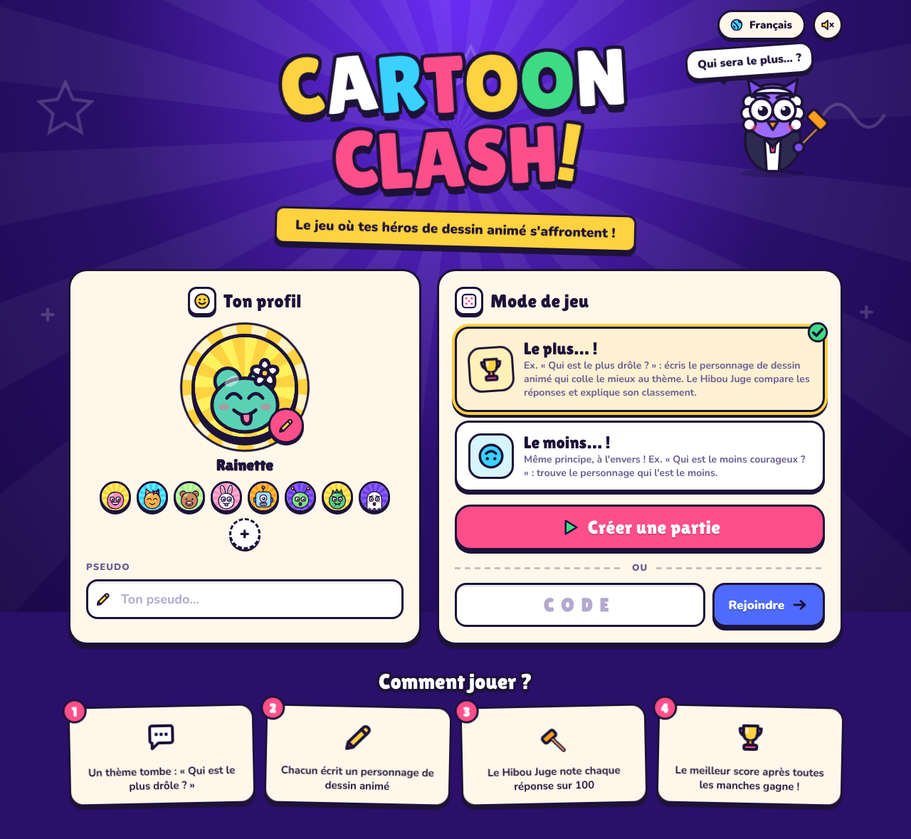
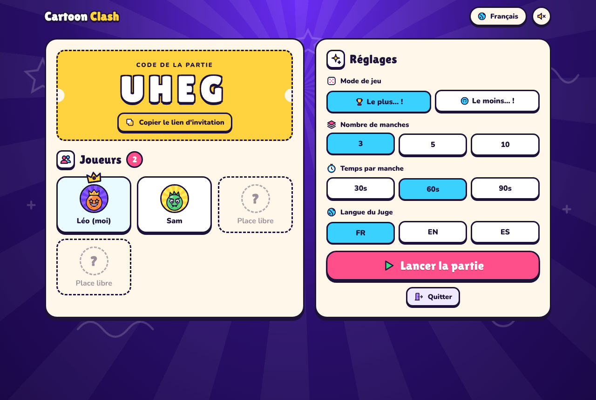
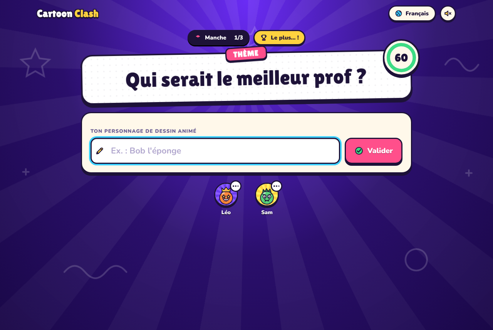
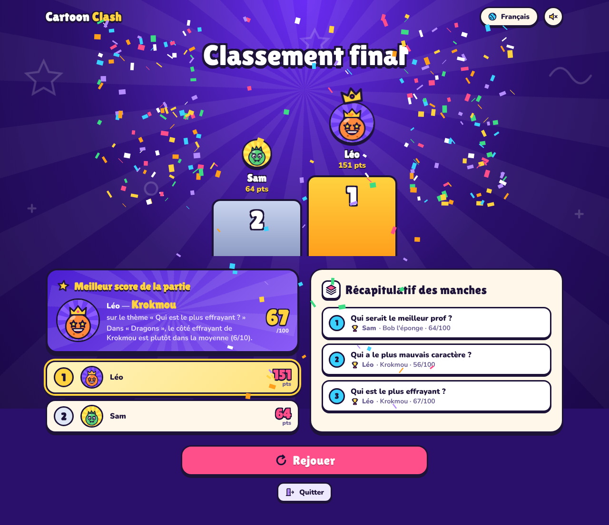

# 🎬 Cartoon Clash

Jeu multijoueur en ligne, jouable dans le navigateur : à chaque manche un thème est tiré
(« Qui est le plus drôle ? », « Qui est le moins courageux ? »…), chaque joueur écrit un
personnage de dessin animé, et le juge compare les réponses, attribue un score sur 100
à chacune et explique brièvement son classement.



| Salon | Manche | Classement final |
|---|---|---|
|  |  |  |

## Fonctionnalités

- **Page d'accueil** : pseudo, langue (🇫🇷 / 🇬🇧 / 🇪🇸), photo de profil modifiable
  (40 personnages cartoon dessinés pour le jeu, ou import de sa propre photo).
- **Parties en ligne** : l'hôte crée une partie et partage un code à 4 lettres (ou un lien
  d'invitation). Jusqu'à 12 joueurs.
- **Réglages avant la partie** (hôte) : 3, 5 ou 10 manches, 30 / 60 / 90 s par manche,
  langue des explications de l'IA.
- **Deux univers** : dessins animés ou mangas.
- **Deux modes de jeu** :
  - **« Le plus… ! »** : ex. « Qui est le plus drôle ? » ;
  - **« Le moins… ! »** : même principe à l'envers, ex. « Qui est le moins courageux ? ».
- **Juge** : chaque personnage est noté d'après ce qu'il montre dans son dessin animé
  (voir ci-dessous) et une courte explication accompagne chaque score.
- **Fin de partie** : podium, classement général, **meilleur score obtenu sur un thème** et
  récapitulatif de chaque manche.
- Reconnexion automatique si un joueur rafraîchit la page.

## Comment le juge note les personnages

Deux univers au choix : **Dessins animés** (plus de 1 360 personnages) et **Mangas** (près de 600 personnages),
chacun jouable en mode « Le plus… » ou « Le moins… ».

- **Sans clé API (par défaut, gratuit)** : chaque personnage est noté de 0 à 10 sur 17 traits (humour, force,
  intelligence, méchanceté, maladresse, courage, gentillesse, paresse, gourmandise, vitesse, mignon, effrayant,
  richesse, mauvais caractère, bavardage, ruse, malchance), d'après son comportement dans son histoire.
  Le score d'un thème est calculé ainsi :
  1. moyenne pondérée des traits du thème (`src/themes.js`), avec des critères secondaires pour départager ;
  2. **talents connus** (`src/data/tags.js` et 5ᵉ colonne des données) : cuisinier, chef, mentor, danseur,
     super-héros, survivant… placent le personnage en haut du thème concerné ;
  3. **classements de référence** (`src/data/rankings.js`) pour les grands débats (le plus fort, le plus
     rapide, le plus intelligent, le plus riche…) ;
  4. le score final = **pourcentage des personnages de la base que le personnage bat** sur ce thème
     (et l'inverse en mode « Le moins… »).
  Les fautes de frappe et les noms français / anglais / espagnols sont reconnus. Un personnage absent de la
  base ne marque que 5 points.
- **Avec une clé API Anthropic (optionnel)** : si la variable `ANTHROPIC_API_KEY` est définie, l'IA Claude juge
  à la place et reconnaît n'importe quel personnage. En cas d'erreur, la base intégrée prend le relais.

### Ajouter des personnages

Une ligne par personnage dans le fichier du studio ou de la série (`src/data/*.js` pour les dessins animés,
`src/manga/*.js` pour les mangas) :

```js
["Nom affiché", "alias|autre nom|nom anglais", "Série FR|Series EN|Serie ES", "hum str int evi clu bra kin laz glu spd cut scr ric tem tal cun unl", "talent|talent"],
```

`npm test` vérifie les notes, les alias en double et les noms utilisés dans les talents et classements.

## Lancer en local

```bash
npm install
npm start
```

Puis ouvrir http://localhost:3000 (dans plusieurs onglets pour tester à plusieurs).

Tests de bout en bout (2 joueurs, 3 manches) : `npm test`.

## Mettre en ligne

Le jeu est un serveur Node.js (Express + Socket.io), il faut donc un hébergeur qui exécute
Node (pas un hébergement de pages statiques). Exemple avec [Render](https://render.com) :

[](https://render.com/deploy?repo=https://github.com/leoedelstein92-collab/test)

Le bouton ci-dessus fait tout en un clic (après connexion à Render). Sinon, à la main :

1. Créer un compte gratuit sur https://render.com en choisissant **« Sign up with GitHub »**.
2. Cliquer sur **New → Blueprint**, autoriser Render à accéder au dépôt, puis le choisir
   (le fichier `render.yaml` configure tout : commande d'installation, de démarrage, offre gratuite).
3. Cliquer sur **Apply** et attendre la fin du déploiement (2-3 minutes).
4. Partager l'URL fournie par Render (`https://cartoon-clash-xxxx.onrender.com`) avec vos amis.

Sur l'offre gratuite, le serveur se met en veille après 15 minutes sans visite : la première
ouverture suivante prend environ 1 minute. Chaque nouveau `git push` redéploie automatiquement.

Railway, Fly.io ou n'importe quel VPS fonctionnent aussi (`npm install && npm start`,
port via la variable `PORT`).

## Structure

| Fichier | Rôle |
|---|---|
| `server.js` | Serveur : parties, manches, minuteur, scores (Socket.io) |
| `src/judge.js` | Choix du juge : Claude (si clé API) ou base intégrée |
| `src/knowledge-judge.js` | Juge par base de personnages + explications |
| `src/characters.js` | Recherche des personnages (fautes de frappe tolérées) |
| `src/data/*.js` | Base des dessins animés (un fichier par studio / type de série), talents, classements |
| `src/manga/*.js` | Base des mangas |
| `src/themes.js` | Thèmes de base « le plus » / « le moins » traduits et traits associés, et tirage des thèmes (familles mélangées, pas de répétition d'une partie à l'autre dans une salle) |
| `src/themes-more.js` | 66 thèmes de plus, par familles : vie quotidienne, apparence et style, idées et société, situations, relations |
| `public/` | Interface web (HTML/CSS/JS, traductions dans `i18n.js`) |

Variables d'environnement optionnelles : `PORT`, `ANTHROPIC_API_KEY`, `CLAUDE_MODEL` (par défaut `claude-opus-5-5`).
