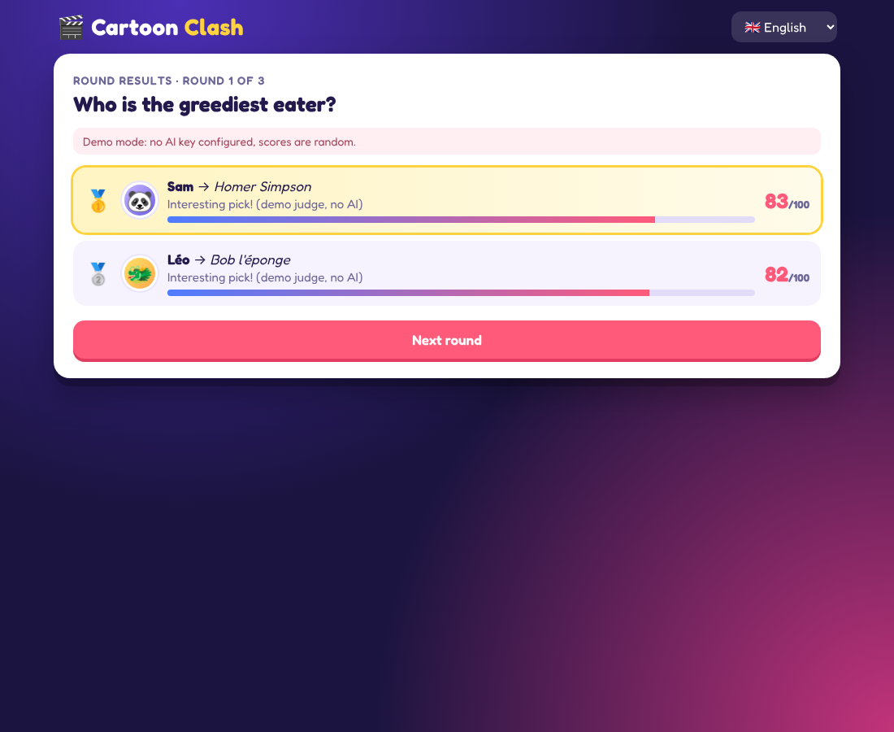

# 🎬 Cartoon Clash

Jeu multijoueur en ligne, jouable dans le navigateur : à chaque manche un thème est tiré
(« Qui est le plus drôle ? », « Qui est le moins courageux ? »…), chaque joueur écrit un
personnage de dessin animé, et le juge compare les réponses, attribue un score sur 100
à chacune et explique brièvement son classement.



## Fonctionnalités

- **Page d'accueil** : pseudo, langue (🇫🇷 / 🇬🇧 / 🇪🇸), photo de profil modifiable
  (48 personnages ou import de sa propre photo).
- **Parties en ligne** : l'hôte crée une partie et partage un code à 4 lettres (ou un lien
  d'invitation). Jusqu'à 12 joueurs.
- **Réglages avant la partie** (hôte) : 3, 5 ou 10 manches, 30 / 60 / 90 s par manche,
  langue des explications de l'IA.
- **Deux modes de jeu** :
  - **« Le plus… ! »** : ex. « Qui est le plus drôle ? » ;
  - **« Le moins… ! »** : même principe à l'envers, ex. « Qui est le moins courageux ? ».
- **Juge** : chaque personnage est noté d'après ce qu'il montre dans son dessin animé
  (voir ci-dessous) et une courte explication accompagne chaque score.
- **Fin de partie** : podium, classement général, **meilleur score obtenu sur un thème** et
  récapitulatif de chaque manche.
- Reconnexion automatique si un joueur rafraîchit la page.

## Comment le juge note les personnages

- **Sans clé API (par défaut, gratuit)** : le jeu utilise une base intégrée de plus de 770 personnages
  (Disney, Pixar, DreamWorks, Illumination, Blue Sky, Sony, Warner / Looney Tunes, Hanna-Barbera,
  Nickelodeon, Cartoon Network, Disney Channel, séries pour adultes, animés japonais et Ghibli,
  dessins animés franco-belges et européens), répartis par studio dans `src/data/` et notés de 0 à 9 sur 17 traits (humour, force, intelligence, méchanceté,
  maladresse, courage, gentillesse, paresse, gourmandise, vitesse, mignon, effrayant, richesse,
  mauvais caractère, bavardage, ruse, malchance), d'après leur comportement dans le dessin animé.
  Chaque thème combine un ou plusieurs traits (`src/themes.js`). Les fautes de frappe et les noms
  français / anglais / espagnols sont reconnus. Un personnage absent de la base ne marque que 5 points.
  Pour en ajouter, il suffit d'ajouter une ligne dans le fichier du studio concerné (`src/data/*.js`).
- **Avec une clé API Anthropic (optionnel)** : si la variable `ANTHROPIC_API_KEY` est définie,
  l'IA Claude juge à la place, ce qui permet de reconnaître n'importe quel personnage. En cas
  d'erreur de l'IA, la base intégrée prend le relais.

## Lancer en local

```bash
npm install
npm start
```

Puis ouvrir http://localhost:3000 (dans plusieurs onglets pour tester à plusieurs).

Tests de bout en bout (2 joueurs, 3 manches) : `npm test`.

## Mettre en ligne

Le jeu est un serveur Node.js (Express + Socket.io), il faut donc un hébergeur qui exécute
Node (pas un hébergement de pages statiques). Exemple avec [Render](https://render.com) :

1. Créer un compte gratuit sur https://render.com en choisissant **« Sign up with GitHub »**.
2. Cliquer sur **New → Blueprint**, autoriser Render à accéder au dépôt, puis le choisir
   (le fichier `render.yaml` configure tout : commande d'installation, de démarrage, offre gratuite).
3. Cliquer sur **Apply** et attendre la fin du déploiement (2-3 minutes).
4. Partager l'URL fournie par Render (`https://cartoon-clash-xxxx.onrender.com`) avec vos amis.

Sur l'offre gratuite, le serveur se met en veille après 15 minutes sans visite : la première
ouverture suivante prend environ 1 minute. Chaque nouveau `git push` redéploie automatiquement.

Railway, Fly.io ou n'importe quel VPS fonctionnent aussi (`npm install && npm start`,
port via la variable `PORT`).

## Structure

| Fichier | Rôle |
|---|---|
| `server.js` | Serveur : parties, manches, minuteur, scores (Socket.io) |
| `src/judge.js` | Choix du juge : Claude (si clé API) ou base intégrée |
| `src/knowledge-judge.js` | Juge par base de personnages + explications |
| `src/characters.js` | Recherche des personnages (fautes de frappe tolérées) |
| `src/data/*.js` | Base des personnages et de leurs traits, un fichier par studio |
| `src/themes.js` | Thèmes « le plus » / « le moins » traduits et traits associés |
| `public/` | Interface web (HTML/CSS/JS, traductions dans `i18n.js`) |

Variables d'environnement optionnelles : `PORT`, `ANTHROPIC_API_KEY`, `CLAUDE_MODEL` (par défaut `claude-opus-5-5`).
